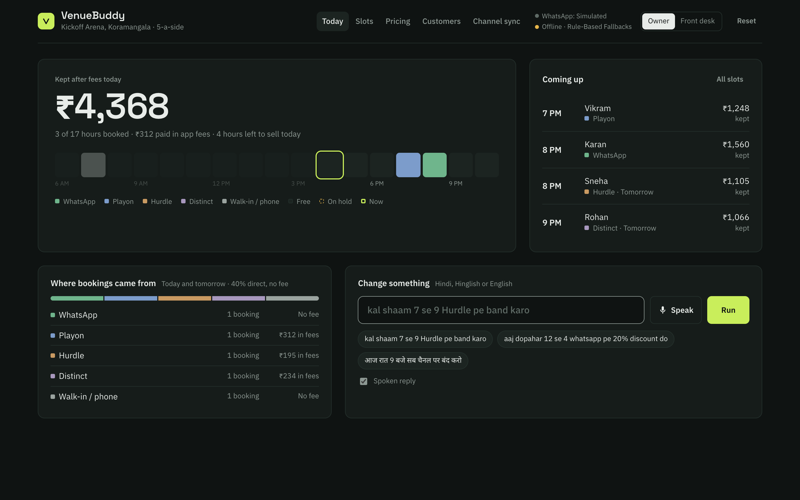

# VenueBuddy

VenueBuddy is omnichannel slot fulfilment for sports venues, shown here running Kickoff Arena (Koramangala). It runs every booking channel (aggregator apps, WhatsApp, phone, walk-in) from one inventory, sets prices per channel, and takes owner commands in Hindi or English.



## Run locally

```bash
npm install
SARVAM_API_KEY=your_key npm start          # http://localhost:3000
```

Real WhatsApp bot (scan the QR with a spare number via WhatsApp → Linked devices):

```bash
WHATSAPP=1 SARVAM_API_KEY=your_key npm start
```

## Environment variables

| Variable | Purpose |
|---|---|
| `SARVAM_API_KEY` | Sarvam AI key for chat/STT. Without it the app runs with fallbacks only. |
| `PORT` | HTTP port (default `3000`). |
| `WHATSAPP` | Set to `1` to start the WhatsApp bot. |
| `WA_AUTH_DIR` | Where the WhatsApp session is stored (default `./.wa-auth`). Point at a persistent volume when deployed. |

## Endpoints

- `/`: dashboard
- `/api/health`: health check
- `/api/events`: server-sent events stream
- `/mcp`: MCP endpoint

## Layout

- `server.js` booking engine, channel-posting router, MCP endpoint (`venuebuddy`), WhatsApp bot and Sarvam proxy. `growth.js` adds customers, segments, offers, nudges and events.
- `public/` the front end: `index.html`, `theme.css` (design tokens), `core.js` and `boot.js`, plus one script and stylesheet per view (`owner`, `staff`, `growth`).

Requirements and design notes are in [`docs/`](docs/).
